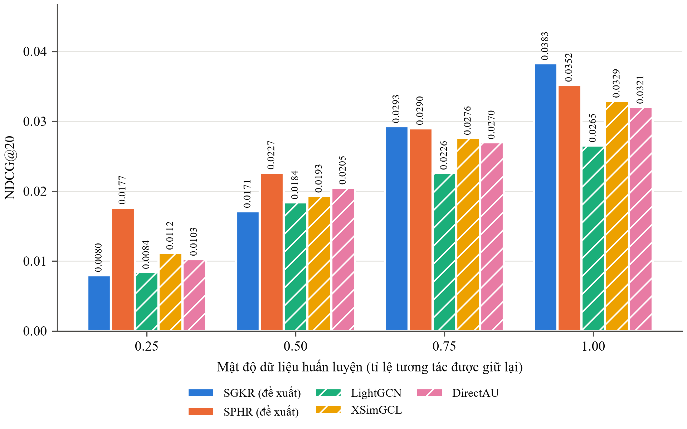
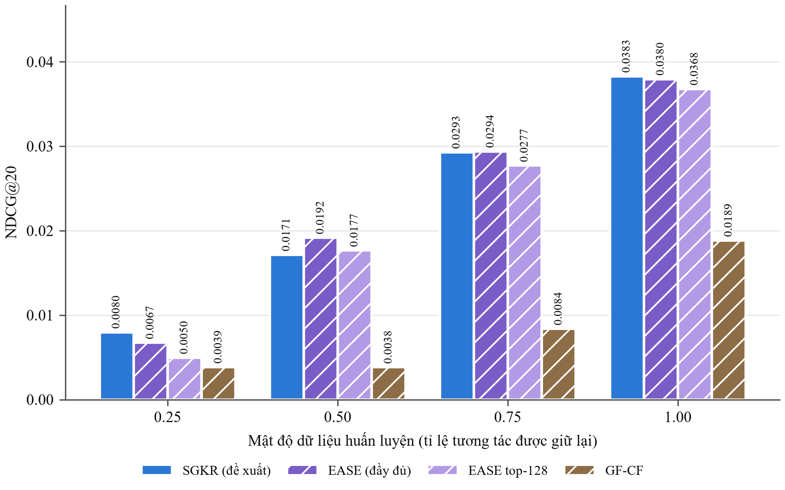

# SGKR & SPHR — Hệ thống khuyến nghị sản phẩm điện tử

**Tiếng Việt** · [English](README.en.md)

Bài tập lớn cá nhân môn *Học máy nâng cao*. Tôi đề xuất hai mô hình khuyến nghị: **SGKR** (hồi quy giữa các sản
phẩm, giải trực tiếp bằng công thức) và **SPHR** (mô hình dựa trên lịch sử mua, huấn luyện bằng gradient), rồi
so sánh với năm mô hình đối chứng đã công bố trên bộ dữ liệu Amazon Electronics. Mọi mô hình dùng chung dữ liệu,
cách chia dữ liệu, bộ đánh giá xếp hạng trên toàn bộ danh mục sản phẩm và các chỉ số; mọi con số trong tài liệu
này đều tính lại được từ các tệp kết quả đã lưu.

## Điểm chính

- **SGKR có NDCG@20 cao nhất khi dùng toàn bộ dữ liệu huấn luyện (0,0383)** và tốt hơn LightGCN, XSimGCL,
  DirectAU một cách có ý nghĩa thống kê (p sau hiệu chỉnh Holm = 0,0006), trong khi chỉ mất **2,5 phút trên
  CPU** để huấn luyện, nhanh hơn khoảng 17 lần so với mạng nơ-ron đồ thị nhanh nhất.
- **SPHR mạnh nhất khi dữ liệu thưa:** NDCG@20 cao nhất khi chỉ dùng 25 % và 50 % dữ liệu huấn luyện.
- **So với các mô hình giải trực tiếp cùng kiểu**, SGKR ngang EASE bản đầy đủ khi dùng toàn bộ dữ liệu (EASE
  cần một ma trận 7,5 GB, không lưu được), và tốt hơn bản EASE rút gọn về cỡ lưu được cũng như GF-CF.
- **Hạn chế:** SGKR không phải tốt nhất ở mức 50 % dữ liệu, và mọi kết quả đến từ một lần chạy với một hạt giống
  ngẫu nhiên duy nhất trên tập kiểm định (xem [Hạn chế](#hạn-chế)).

## Mục lục

[Tái lập kết quả](#tái-lập-kết-quả) · [Demo](#demo) · [Mô hình](#mô-hình) · [Dữ liệu](#dữ-liệu) ·
[Kết quả](#kết-quả) · [Giao thức đánh giá](#giao-thức-đánh-giá) · [Hạn chế](#hạn-chế) ·
[Cấu trúc thư mục](#cấu-trúc-thư-mục) · [Tài liệu tham khảo](#tài-liệu-tham-khảo)

## Tái lập kết quả

```bash
conda create -n AML python=3.11 && conda activate AML
pip install -r requirements.txt

python scripts/prepare_data.py                         # tải dữ liệu từ SNAP và dựng bộ dữ liệu
python scripts/audit_data.py                           # kiểm tra dữ liệu

python scripts/train_model.py --model sgkr --density 1.0
#   --model    sgkr | sphr | lightgcn | xsimgcl | directau | ease | gfcf
#   --density  1.0 | 0.75 | 0.5 | 0.25   (tỉ lệ dữ liệu huấn luyện được giữ lại)

python scripts/summarize_results.py                    # bảng tổng hợp results/summary.csv
python scripts/make_report.py                          # hình H1–H8, bảng B1–B4 (so sánh chính)
python scripts/make_closed_form_report.py              # hình và bảng B5–B6 (so sánh bổ sung)
python scripts/verify_results.py                       # tính lại mọi chỉ số từ các tệp đã lưu
python -m pytest -q tests                              # chạy kiểm thử
```

Mỗi lần chạy ghi kết quả vào `results/<mô hình>/d<tỉ lệ>/seed42/`: chỉ số (`metrics.json`), dự đoán trên tập
kiểm định, trọng số mô hình đã lưu (checkpoint), lịch sử huấn luyện `history.csv` (với mô hình huấn luyện lặp)
và thư mục `logs/` (kế hoạch chạy, bản lưu mã nguồn, tiến độ, tài nguyên đã dùng). Lần chạy nào đã xong sẽ được
bỏ qua. Các mô hình huấn luyện lặp chạy đủ 200 vòng (epoch), không dừng sớm, và giữ lại trọng số có NDCG@20 trên
tập kiểm định cao nhất. Lệnh `python scripts/run_experiments.py` chạy toàn bộ thực nghiệm chính: SGKR, SPHR và
3 mạng nơ-ron đồ thị ở cả 4 tỉ lệ dữ liệu.

**Phần cứng.** SGKR và GF-CF chạy được trên CPU máy tính cá nhân. SPHR và các mạng nơ-ron đồ thị được huấn luyện
trên GPU của Kaggle (`kaggle/kaggle_train.ipynb`). EASE phải nghịch đảo một ma trận dày 44.843 × 44.843 nên cần
**khoảng 9,1 GB RAM trống**; mô hình này được chạy trên CPU của Kaggle (`kaggle/kaggle_ease.ipynb`).

## Demo

```bash
python -m streamlit run app/streamlit_app.py
```

Giao diện bố trí cho màn hình 1920 × 1080, gồm ba thẻ:

- **Gợi ý cho khách:** 10 gợi ý hàng đầu của cả 7 mô hình đặt cạnh nhau, đánh dấu sản phẩm khách mua tiếp theo,
  kèm lời giải thích của SGKR cho gợi ý thứ nhất.
- **Khách mới:** tự tạo lịch sử mua bằng cách tìm sản phẩm. SGKR, SPHR, EASE và GF-CF gợi ý được ngay; các mạng
  nơ-ron đồ thị chỉ phục vụ được người dùng đã có trong dữ liệu huấn luyện.
- **Đánh giá mô hình:** bảng xếp hạng, biểu đồ, kiểm định thống kê và hình trong báo cáo, chia thành nhóm cần
  huấn luyện và nhóm giải trực tiếp.

Demo nạp các trọng số mô hình đã lưu và chỉ đọc tập huấn luyện và tập kiểm định.

## Mô hình

| Mô hình | Loại | Cách tạo ra | Phần cứng |
|---|---|---|---|
| **SGKR** (đề xuất) | Hồi quy giữa các sản phẩm | Giải trực tiếp bằng công thức | CPU |
| **SPHR** (đề xuất) | Phân rã dựa trên lịch sử mua | Tối ưu bằng Adam, hàm softmax trên toàn danh mục | GPU |
| LightGCN [1] | Mạng nơ-ron đồ thị | Huấn luyện bằng gradient, tối đa 200 vòng | GPU |
| XSimGCL [2] | Mạng nơ-ron đồ thị kết hợp học tương phản | Huấn luyện bằng gradient, tối đa 200 vòng | GPU |
| DirectAU [3] | Tối ưu trực tiếp độ khớp và độ phân tán | Huấn luyện bằng gradient, tối đa 200 vòng | GPU |
| EASE [4] | Hồi quy giữa các sản phẩm | Giải trực tiếp bằng công thức | CPU |
| GF-CF [5] | Lọc tín hiệu trên đồ thị | Giải trực tiếp (phân tích SVD) | CPU |

**SGKR** là hồi quy ridge giữa các sản phẩm, có thêm ràng buộc theo đồ thị. Mỗi sản phẩm được dự đoán từ 128
sản phẩm liên quan nhất với mức phạt điều chỉnh theo từng sản phẩm; hệ phương trình được giải chính xác bằng
phân tích Cholesky, trong đó chính sản phẩm cần dự đoán được loại khỏi dữ liệu đầu vào của nó. SGKR không có
tham số riêng cho từng người dùng và không cần thuật toán tối ưu, nên chấm điểm được ngay cho bất kỳ lịch sử mua
nào, kể cả người dùng chưa từng xuất hiện khi huấn luyện. Mô hình còn giải thích được mỗi gợi ý bằng những sản
phẩm trong lịch sử đóng góp nhiều nhất.

**SPHR** biểu diễn mỗi người dùng bằng lịch sử mua đã chuẩn hóa, trên các bảng véc-tơ sản phẩm đã được lọc
khuếch tán qua đồ thị:

```math
\mathrm{score}(u, i) = \mathbf{q}_u^{\top} \tilde{\mathbf{v}}_i + b_i,
\qquad \mathbf{q}_u = |H_u|^{-1/2} \sum_{j \in H_u} \tilde{\mathbf{s}}_j
```

trong đó $`H_u`$ là tập sản phẩm người dùng $`u`$ đã mua, $`\tilde{\mathbf{s}}_j`$ và $`\tilde{\mathbf{v}}_i`$
là véc-tơ nguồn và véc-tơ đích đã lọc của sản phẩm, còn $`b_i`$ là độ lệch riêng của sản phẩm $`i`$. Mô hình
được tối ưu bằng Adam với hàm softmax trên toàn danh mục, mỗi lần che một sản phẩm trong lịch sử để dự đoán.
Giống SGKR, SPHR phục vụ được người dùng mới chỉ từ lịch sử mua.

Ba mạng nơ-ron đồ thị học một véc-tơ riêng cho từng người dùng khi huấn luyện, nên không gợi ý được cho người
dùng mới nếu không huấn luyện lại.

## Dữ liệu

Bộ đánh giá sản phẩm Amazon Electronics, phiên bản chỉ giữ người dùng và sản phẩm có ít nhất 5 đánh giá [6, 7].
Đánh giá từ 4 sao trở lên được coi là một lượt mua phù hợp; lịch sử của mỗi người dùng được chia theo thời gian.

| Thống kê | Giá trị |
|---|---:|
| Số người dùng | 124.895 |
| Số sản phẩm | 44.843 |
| Số tương tác huấn luyện | 858.192 |
| Số tương tác kiểm định | 107.274 |
| Độ thưa của dữ liệu huấn luyện | 99,98 % |
| Độ dài lịch sử mua, trung bình / trung vị | 6,87 / 5 |

Để đo độ bền khi dữ liệu khan hiếm, mọi mô hình còn được huấn luyện trên **75 %, 50 % và 25 %** số tương tác
huấn luyện (lấy mẫu cố định với hạt giống 42).

## Kết quả

### Độ chính xác

NDCG@20 trên tập kiểm định: mỗi mô hình xếp hạng toàn bộ danh mục, loại các sản phẩm người dùng đã mua; có
107.215 người dùng được đánh giá.

| Mô hình | 25 % | 50 % | 75 % | 100 % | Thời gian huấn luyện ở 100 % |
|---|---:|---:|---:|---:|---:|
| **SGKR** | 0,0080 | 0,0171 | 0,0293 | **0,0383** | 2,5 phút (CPU) |
| **SPHR** | **0,0177** | **0,0227** | 0,0290 | 0,0352 | 127 phút (GPU) |
| XSimGCL | 0,0112 | 0,0193 | 0,0276 | 0,0329 | 63 phút (GPU) |
| DirectAU | 0,0103 | 0,0205 | 0,0270 | 0,0321 | 85 phút (GPU) |
| LightGCN | 0,0084 | 0,0184 | 0,0226 | 0,0265 | 43 phút (GPU) |
| EASE | 0,0067 | 0,0192 | **0,0294** | 0,0380 | 11 phút (CPU) |
| GF-CF | 0,0039 | 0,0038 | 0,0084 | 0,0189 | 45 phút (CPU) |

Thời gian huấn luyện đo trên phần cứng khác nhau (CPU và GPU), nên chỉ so được theo bậc độ lớn.

<p align="center">
  
  
</p>
<p align="center"><sub>NDCG@20 theo tỉ lệ dữ liệu huấn luyện. Trái: SGKR, SPHR và các mạng nơ-ron đồ thị.
Phải: SGKR và các mô hình giải trực tiếp.</sub></p>

### So sánh thống kê

Các phép so sánh chia thành hai nhóm, mỗi nhóm hiệu chỉnh Holm riêng. Mọi kiểm định là bootstrap ghép cặp theo
người dùng (10.000 lần lấy mẫu lại), một phía, theo hướng mô hình đề xuất tốt hơn.

**So sánh chính: mô hình đề xuất với các mạng nơ-ron đồ thị** (bảng B3, toàn bộ dữ liệu).

| So sánh | Chênh lệch NDCG@20 | Khoảng tin cậy 95 % | p Holm |
|---|---:|---|---:|
| SGKR − LightGCN | +0,0117 | [+0,0109; +0,0126] | 0,0006 |
| SGKR − XSimGCL | +0,0054 | [+0,0046; +0,0061] | 0,0006 |
| SGKR − DirectAU | +0,0062 | [+0,0055; +0,0070] | 0,0006 |
| SPHR − LightGCN | +0,0086 | [+0,0080; +0,0093] | 0,0006 |
| SPHR − XSimGCL | +0,0023 | [+0,0017; +0,0028] | 0,0006 |
| SPHR − DirectAU | +0,0031 | [+0,0025; +0,0038] | 0,0006 |

**So sánh bổ sung: SGKR với các mô hình giải trực tiếp** (bảng B5–B6, hiệu chỉnh Holm trên 3 phép so sánh ở mỗi
tỉ lệ dữ liệu). Nhóm so sánh này được lập sau khi đã xem kết quả nên chỉ mang tính khám phá.

| SGKR so với | 25 % | 50 % | 75 % | 100 % |
|---|---|---|---|---|
| EASE bản đầy đủ (7,5 GB) | SGKR hơn | EASE hơn | ngang (p = 0,72) | ngang (p = 0,051) |
| EASE rút gọn 128 trọng số (25–32 MB) | SGKR hơn | EASE hơn | SGKR hơn | SGKR hơn |
| GF-CF | SGKR hơn | SGKR hơn | SGKR hơn | SGKR hơn |

Trọng số đã lưu của SGKR chiếm 6–41 MB tùy tỉ lệ dữ liệu, cỡ tương đương bản EASE rút gọn.

**Chỗ SGKR không thắng.** Ở mức 50 % dữ liệu, SGKR thấp hơn cả 3 mạng nơ-ron đồ thị và cả hai bản EASE. Ở mức
25 % và 50 %, SPHR là mô hình mạnh nhất. GF-CF yếu trên dữ liệu rất thưa này vì cách chuẩn hóa của nó ưu tiên
những sản phẩm ít người mua.

## Giao thức đánh giá

- **Mục tiêu dự đoán:** sản phẩm mua tiếp theo của mỗi người dùng. Mọi mô hình xếp hạng toàn bộ 44.843 sản phẩm,
  loại các sản phẩm người dùng đã mua, và được đánh giá trên cùng một nhóm người dùng.
- **Chỉ số:** NDCG@10/20, Recall@10/20 và MRR@20.
- **Chọn cấu hình:** chỉ so sánh trên một nửa số người dùng của tập kiểm định (chia theo mã băm); nửa còn lại
  dành để xác nhận. Mọi quyết định được ghi vào nhật ký, chỉ thêm, không sửa.
- **Kiểm định thống kê:** bootstrap ghép cặp theo người dùng, một phía, hiệu chỉnh Holm trong từng nhóm so sánh.
- **Cấu hình mô hình đối chứng:** EASE và GF-CF mỗi mô hình dùng một cấu hình cố định, không tinh chỉnh trên dữ
  liệu này: EASE với λ = 300 (giá trị giữa của lưới thường dùng 100/300/1000), GF-CF theo mặc định của tác giả
  (k = 256, α = 0,3). Demo dùng bản EASE rút gọn, chỉ giữ 128 trọng số lớn nhất của mỗi sản phẩm; mọi số liệu EASE
  ở trên là bản đầy đủ, trừ khi ghi rõ là bản rút gọn.

## Hạn chế

- **Một hạt giống ngẫu nhiên (42).** Chưa đo độ dao động giữa các lần chạy; khoảng tin cậy chỉ phản ánh sai số
  do lấy mẫu người dùng.
- **Chỉ trên tập kiểm định.** Tập kiểm tra cuối cùng (test) được giữ riêng; không con số nào ở đây là kết quả
  kiểm tra cuối cùng.
- **So sánh bổ sung mang tính khám phá.** Nhóm so sánh với các mô hình giải trực tiếp được thêm vào sau khi đã
  biết kết quả.
- **Mô hình giải trực tiếp chưa tinh chỉnh.** EASE và GF-CF không được tinh chỉnh trên dữ liệu này, nên điểm của
  chúng có thể thấp hơn mức tốt nhất chúng đạt được.
- **Một bộ dữ liệu.** Mọi kết luận chỉ áp dụng cho Amazon Electronics.

## Cấu trúc thư mục

```
configs/   cấu hình đã chốt: sgkr, sphr, lightgcn, xsimgcl, directau, ease, gfcf, common
src/       xử lý dữ liệu, bộ đánh giá, hàm mất mát, vòng huấn luyện, các mô hình (src/models/*.py)
scripts/   các lệnh chạy; scripts/verify/ kiểm chứng bằng SymPy các công thức giải trực tiếp
app/       demo Streamlit: streamlit_app.py (giao diện), recommender.py (nạp mô hình), benchmark.py (thống kê)
kaggle/    sổ tay (notebook) dùng trên Kaggle
results/   mỗi lần chạy một thư mục, cùng bảng summary.csv (git chỉ lưu trọng số và lịch sử huấn luyện)
reports/   figures/ (hình PNG) và tables/ (bảng CSV)
tests/     bộ kiểm thử pytest
```

## Tài liệu tham khảo

1. X. He, K. Deng, X. Wang, Y. Li, Y. Zhang, M. Wang. *LightGCN: Simplifying and Powering Graph Convolution
   Network for Recommendation.* SIGIR 2020.
2. J. Yu, X. Xia, T. Chen, L. Cui, N. Q. V. Hung, H. Yin. *XSimGCL: Towards Extremely Simple Graph Contrastive
   Learning for Recommendation.* IEEE TKDE 2023.
3. C. Wang, Y. Yu, W. Ma, M. Zhang, C. Chen, Y. Liu, S. Ma. *Towards Representation Alignment and Uniformity in
   Collaborative Filtering.* KDD 2022.
4. H. Steck. *Embarrassingly Shallow Autoencoders for Sparse Data.* WWW 2019.
5. Y. Shen, Y. Wu, Y. Zhang, C. Shan, J. Zhang, K. B. Letaief, D. Li. *How Powerful is Graph Convolution for
   Recommendation?* CIKM 2021.
6. R. He, J. McAuley. *Ups and Downs: Modeling the Visual Evolution of Fashion Trends with One-Class
   Collaborative Filtering.* WWW 2016.
7. J. McAuley, C. Targett, Q. Shi, A. van den Hengel. *Image-Based Recommendations on Styles and Substitutes.*
   SIGIR 2015.
